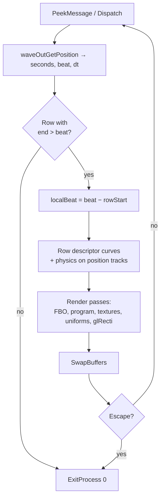

# 2. Main loop

Time comes only from the audio playback position. Each frame converts it to seconds and beats, selects a timeline row, evaluates animation and physics and draws the shader chain. The program exits at beat 600.

## Initialization

Music synthesis runs on its own thread in parallel with graphics setup. Playback starts last.

| Addresses | Step |
|---|---|
| `0x406379` | Synth init `0x4010e3`: score, patch, graph, `gm.dls` |
| `0x40639f` | `CreateThread(0x401636, 0x00f02070)` — synthesize the whole track into the buffer |
| `0x4063b9..0x40640d` | Window, DC, pixel format, WGL context; client size → `0x0b17bf2c` / `0x0b17bfac` |
| `0x406430..0x40648d` | Loading screen: shader `0x426c58` drawn until `GetTickCount` counts 1 s |
| `0x40648f..0x4064c0` | Copy physics parameters of the 4 characters |
| `0x4064e7..0x406dac` | Build shader source pointer arrays (a chain of `MOV`s) |
| `0x406dad..0x406ded` | 30 programs: `glCreateShaderProgramv(GL_FRAGMENT_SHADER, n, strings)` |
| `0x406e01..0x406f7a` | 13 FBOs and 15 RGBA32F textures |
| `0x406f9c..0x407987` | Row-0 tracks and initialization passes: atlas generation |
| `0x4079d6` / `0x407a58` | Read the cloud atlas back to the CPU → 128³ 3D texture |
| `0x407ae9..0x407b0c` | `waveOutOpen` → `waveOutPrepareHeader` → `waveOutWrite` of the whole buffer |

The full 19 964 544-frame buffer is submitted while the thread is still writing it. This works because synthesis runs faster than real time.

Audio format (`0x43702c`): IEEE float, stereo, 44 100 Hz, 8-byte block.

## Clock

Seconds and beat are derived from the playback position in samples, rounded to float32 at every step:

```
waveOutGetPosition(&mmtime{wType = TIME_SAMPLES})   // cursor: u32 at 0x437024
seconds = f32( f32(f64(cursor)) / 44100 )
beat    = f32( seconds * f32(80/60) )               // 80 BPM
dt      = f32( seconds - prevSeconds )              // prevSeconds = 0 at start
```

The rounding points (double → float → divide) decide which row a frame lands in at a boundary. `GetTickCount` is used only for the loading screen.

## Frame



| Step | Address |
|---|---|
| Window messages | `0x407b6e` |
| Playback position | `0x407b91` |
| Row selection | `0x407bee` |
| Curves | `0x407c64` |
| Physics | `0x408291` |
| Render passes | `0x4082c4` |
| `SwapBuffers` | `0x4085fd` |
| Escape check | `0x408603..0x408611` |

## Exit

The program exits when no row matches the current beat: beat 600 = 450 s = cursor 19 845 000 → `0x407c20` → `ExitProcess(0)` at `0x408618`.

Audio is longer than video: 19 964 544 frames = 452.71 s. The last score event is at sample 19 897 792, so the tail after 450 s really is generated.

## Determinism

The picture is a function of the playback position and the physics history.

- With position `735·n` (44 100 / 60) there are exactly 27 000 frames `0..26999`. Query `n = 27000` is beat 600 and exit.
- Physics depends on the sequence of `dt` values, so a frame cannot be computed in isolation from earlier ones.
- Graphics never calls an RNG: noise and grain are coordinate and time hashes in the shaders.
- Main-thread FP mode: x87 CW `0x027f` (53-bit, round to nearest), MXCSR `0x1f80`. The synth thread has its own mode, see [06-audio.md](06-audio.md).
