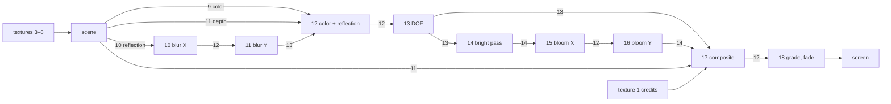

# 5. Rendering

Each frame is 19 full-screen fragment-shader passes: 9 initialization passes, SDF raymarching of the scene and 9 post-processing passes. There is no geometry; each pass is `glRecti(-1, -1, 1, 1)` with the fixed-function vertex path.

## Shaders

30 programs are assembled from 93 GLSL fragments totalling 117 040 bytes.

- Recipes `(count, offset)` at `0x4357e0` list which fragments to concatenate. A shared library (SDF math, noise, lighting, raymarcher) goes into every scene.
- Programs are created with `glCreateShaderProgramv`; there is no separate vertex shader.
- Outputs `outColor0/1/2` have no `layout(location)` and are bound implicitly at link time.
- Program 0 declares `#version 450` but uses compatibility-profile features. Strict drivers need the header `#version 450 compatibility`.

## Resources

**FBOs** — 13, records at `0x4358d0` with a 20-byte stride: `(attachments, width, height, divisor, initOnly)`. `width = 0` means the window size, integer-divided by `divisor`.

**Textures** — 15, RGBA32F, level 0, LINEAR filtering:

| Index | Size | Purpose |
|---|---|---|
| 0 | 16384 × 128 | cloud atlas → 128³ volume |
| 1 | 4096² | credits lettering (SDF) |
| 2, 3 | 1024² | noise bands, seamless noise |
| 4, 5, 6 | 2048² | Voronoi, panels (height and derivatives) |
| 7, 8 | 1024² | stars |
| 9, 10, 11 | window size | scene pass outputs |
| 12, 13, 14 | window size | post-processing buffers |

Initialization textures use REPEAT; timeline textures use `GL_CLAMP` (`0x2900`), not `CLAMP_TO_EDGE`.

## Texture generators (programs 0–8)

All textures are procedural: 9 shaders draw them at startup.

| Prog. | Generates |
|---|---|
| 0 | Cloud atlas. R — 5-octave value noise and inverted 3-octave Worley; G/B — inverted 32-octave noise at frequencies 48 / 192 |
| 1 | Credits lettering atlas (SDF from glyph macros) |
| 2 | 4 simplex-noise bands |
| 3 | Seamless version of the bands (shift and blend) |
| 4 | Periodic Voronoi: distance, border, cell |
| 5, 6 | Manhattan Voronoi, panel height and derivatives |
| 7, 8 | 10 000 hash-placed stars, brightness 0.0034 / 0.0025 |

**Cloud volume.** Atlas 0 is read back to the CPU (`glGetTexImage`, `0x4079d6`) and uploaded as a 128³ 3D texture (`0x407a58`) with no reordering: voxel `(x, y, z)` = atlas pixel `(x + 128·y, z)`. The shader samples it at `(x + 0.5, z + 0.5, y) / 128`. It sits on unit 0 as `uClouds`, LINEAR, REPEAT.

## Scene pass (programs 9, 19–29)

The scene is drawn by sphere tracing a distance function and writes three buffers.

Contents: uniforms `0x40ae60`, SDF math `0x40b1a8`, hash and noise `0x40d358`, models `0x40f488`, materials `0x4117e8`, UI `0x4123a8`, lighting `0x415e80`, raymarcher `0x4184b8`, plus the scene's own fragment.

Raymarcher steps:
1. Sphere tracing of the SDF.
2. Normal from finite differences plus bump.
3. Ambient occlusion from 4 distances.
4. Scene lighting and fog.
5. One secondary reflection.
6. Clouds — programs 20 and 21 only: up to 40 density samples, 3 shadow samples each.

| Output | RGB | Alpha |
|---|---|---|
| `out0` | primary color | reflection weight |
| `out1` | reflection color | blur radius (roughness) |
| `out2` | depth | — |

## Pass graph

| Pass | Inputs | Output | Does |
|---|---|---|---|
| scene | 3, 4, 5, 6, 7, 8 | 9, 10, 11 | raymarching |
| 10 | 10 | 12 | reflection blur in X: 15 tap pairs, triangular weights, radius from alpha |
| 11 | 12 | 13 | same in Y |
| 12 | 9, 13, 11 | 12 | color plus weighted reflection, depth in alpha |
| 13 | 12 | 13 | DOF: 4 spirals × 15 samples, 7-sided aperture, CoC from `uSharpDistance` / `uBlurSize` |
| 14 | 13 | 14 | bright pass: `max(color - 1, 0)` |
| 15 | 14 | 12 | bloom in X: 19 pairs, `uBloomKernelSize` |
| 16 | 12 | 14 | bloom in Y |
| 17 | 13, 14, 11, 1 | 12 | bloom, credits, vignette, grain (time hash) |
| 18 | 12 | screen | color grade, clamp, fade |

The fade is defined by shader `0x41b0b0`: fade-in over the first 4 s, a dip around beat 554 (415.5 s), fade to black by beat 597 (447.75 s).

## Uniforms and textures

Every pass gets `uTimeResolution = (globalSeconds, passWidth, passHeight)`. The shader computes the beat itself: `uTimeResolution.x · 80/60`.

- Input textures: base location of the `sTD2DInputs` array plus the index, unit `index + 1` (`0x40842b..0x40844a`). Unit 0 holds `uClouds`.
- Only uniforms from the current row's descriptors are uploaded (`0x4084b5..0x40850d`).

**Uniforms live in the program object.** If a row does not set a uniform, the program keeps the value last uploaded to it, possibly many scenes earlier. Example: row 43 (program 21) does not set `uMainCharacterPos`, so the shader still has the value from row 11, although physics has moved on since.

**Passes 0–8 run every frame.** In the loop the initialization descriptors skip FBO, program and uniform setup, but `glRecti` is still called (`0x4082df → 0x4085c9`): 9 draws with whatever state the previous pass left.
