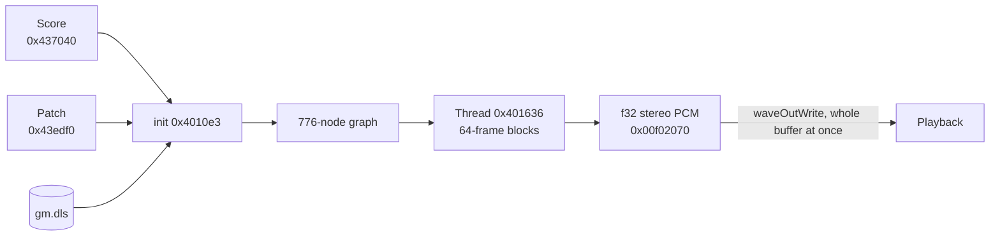

# 6. Audio: the 64klang2 synthesizer

The music is not stored as audio. The EXE holds a score, a synthesis graph and node code; at startup the synth thread renders all 452.71 s into a 160 MB PCM buffer.

The code matches the public 64klang player (`gopher-atz/64klang`, commit `23d7cfc`, 2018): all 79 constants and the RNG match, and the whole render matches bit for bit. Differences are listed at the end.

## Data flow



## Initialization (`0x4010e3`)

1. **Delta decoding.** Everything from `0x437050` to `0x43edcb` is one stream: each byte = previous + current (mod 256), with no reset between parts.
2. Patch constants: 200 mono and 27 stereo float32 → float64.
3. Recursive node creation (`0x405de9` / `0x405e78`).
4. `gm.dls` load (see [01-packing-and-startup.md](01-packing-and-startup.md)): each `data` chunk is a PCM16 sample, converted to float64 by dividing by 32 768, duplicated in time and into both channels. Sample rates in the bank are ignored.
5. Tick counter `0x0b16bd20` = 1: ticks are one-based.

## Score

The score is a set of event streams laid out in byte planes.

Header `0x437040`: `f32 bpm, u32 frameLimit = 19964544, u32 quantum = 64, u32 deltaSize`.

Stream header (u32):

| Bits | Field |
|---|---|
| 0–15 | event count |
| 16–23 | CC number |
| 24–27 | type: 0 — note off, 1 — note on, 3 — CC |
| 28–31 | channel |

Planes (all bytes of one plane, then the next):
- 3 planes — 24-bit time, multiplied by 64, so times fall on block boundaries;
- 1 plane — note or CC value;
- 5th plane, note-on only — velocity.

CC value: selector 0 → `(v − 128) / 128`, others → `v / 128`. CCs 0, 1, 2, 3, 4, 6 are used. 5 718 note events in total (2 859 pairs) and 1 557 CCs.

## Synth thread (`0x401636`)

The thread renders in 64-frame blocks; score events are applied at the start of each block.

```
MXCSR = 0xffc0                   // toward zero, FTZ, DAZ — this thread only
for block in 0 .. 311946:
    for each event stream in order: dispatch events with time <= current sample
    repeat 64:
        L, R = tick(graph root)
        buf[i] = (f32 L, f32 R)
        tick += 1
        free deferred allocations
```

19 964 544 frames in total. Node parameters update every 16 samples, when `(tick & 15) == 1`.

## Graph (patch)

The patch is a sequence of WORDs starting at `0x43edf0`; nodes reference each other by offset.

- Node header: bits 0–6 — type, 7–13 — input count, bit 15 — global node.
- Then WORD references to inputs, then mode words.
- 776 nodes, 46 types, 43 distinct tick functions. Tables: tick `0x4096c0`, init `0x4097e0`.
- The graph allows shared nodes and cycles. A node stores the tick it was last evaluated on (`node + 0x14`) and returns the cached value within the same tick.

**Voices.** A note goes through the channel's note controllers to the first matching range, and a voice manager instantiates a copy of the voice subgraph. A voice lives while its ADSR gate is open. 35 of the 37 voice managers receive notes. There is one arpeggiator (channel 5): 32 velocity / gate / transpose steps, data at `0x440bea`.

## Node kernels

| Node (address) | Algorithm |
|---|---|
| ADSR `0x40226d` | 5 inputs; time `1 / (max(x, 0)³ · 418381.75 + 1)`; linear or exponential decay; active during attack or while level > 1/65536 |
| OSCILLATOR `0x402c12`, LFO `0x402aa8` | sine, saw, pulse, band-limited triangle and pulse, noise tone; unison is sequential detuning; random phase always makes 7 RNG calls |
| NOISEGEN `0x402db1` | white, pink (3 poles), brown noise |
| BQFILTER `0x403008` | DF-II-T biquad, `Q = exp2(in · 10)`, cascaded |
| SVFILTER `0x405986` | state-variable, 2 passes per sample |
| ONEPOLE, ONEZERO, DCFILTER | first-order filters |
| FORMANT `0x405b62` | 5 resonators per vowel, 375-coefficient table |
| DISTORTION `0x403c97` | overdrive, soft clip, limiter |
| COMPEXP `0x40477a` | compressor / expander, log-domain envelope, `ratio = exp2(in · 6)` |
| DELAY, COMBDELAY, FBDELAY | 4 s stereo buffer, delay in `[4, 176399]`, linear or allpass interpolation, BPM sync |
| REVERB `0x4044f1` | 8 parallel combs and 4 serial allpasses, 23-sample stereo offset |
| TRIGGER, TRIGGERSEQ | 0.5 threshold; step sequencer with 2 pattern banks |
| SAMPLER `0x404dd0`, GMDLS `0x405b12` | bank sample, linear interpolation, pitch, loop |
| GLITCH `0x40514d` | tape stop, retrigger, shuffle, reverse over a recorded buffer |
| MUL, ADD, MIX, CLIP, PAN, etc. | arithmetic and routing |

## Math

The synth uses its own math, not libm; output depends on it bit for bit.

- `s_rand` (`0x401038`): signed 32×32→64 multiply (`PMULDQ`), shuffle, low-word conversion.
- `s_exp2` (`0x401066`): integer and fractional parts, 6 polynomial steps, exponent assembly.
- `sin`: range reduction plus polynomial. `log2`: exponent and mantissa plus an odd polynomial in `(m − 1) / (m + 1)`.
- Everything is float64 SSE2, with separate multiply and add.

There are two RNGs: a global one (`0x0b16b810`) and a local one in each GLITCH (`node + 0x190`). When shuffling, GLITCH temporarily swaps its state into the global one.

## Samples

15 bank samples are heard, 85 548 bytes of PCM16. The graph has 23 samplers and 17 GMDLS nodes referring to 16 samples, but sample 266 hangs off a voice that never receives notes. Zeroing everything in the bank except those 15 leaves the output bit-identical.

## Differences from public 64klang

| What | In the binary | In the source |
|---|---|---|
| Freeing memory | after every sample | after each 64-frame block |
| `renderDone` flag | not written; the thread just exits | written |
| ADSR inputs | 5 (`ADSR_SKIP_TRIGGER_GATE`) | 7 |

Audio affects graphics only through the playback position. The main loop does not read amplitudes or events from the PCM.
