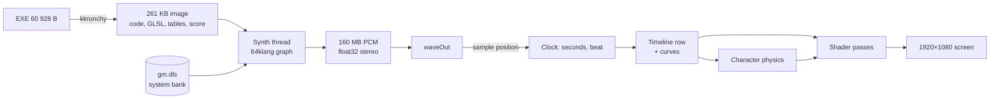

# Eidolon "Poo-Brain": how the original binary works

The whole 450-second intro is computed at startup from 60 928 bytes. A 64klang graph synthesizes the music. Full-screen fragment shaders draw the picture, driven by a timeline that follows the audio playback position.

Русская версия: [../ru/README.md](../ru/README.md)

**Subject:** `Eidolon - Poo-Brain (native).exe`, 60 928 bytes, SHA-256 `376b476c358a969da7d5d45c091355520453086ee8cd22625fdbb4fa3a9fd6be`; Revision 2017, 64k category. Music by 64klang2 (Gopher). The 720p and 1080p builds differ from it in 24 bytes of resolution constants.

For the Rust port and its modified assembly packer, see
[the port guide](../rust/README.md), [compact ASM source map](../rust/asm-map.md#compact-build-and-modified-assembly)
and [current size results](../../size/RESULTS.md). Addresses and file-layout
measurements in these original-binary chapters refer to the subject pinned above.

## Overview

## Files

| File | Contents |
|---|---|
| [01-packing-and-startup.md](01-packing-and-startup.md) | EXE layout, kkrunchy unpacker, imports, control transfer, `gm.dls` |
| [02-main-loop.md](02-main-loop.md) | Initialization, clock, frame steps, exit |
| [03-timeline-and-curves.md](03-timeline-and-curves.md) | Timeline, scenes, uniform descriptors, curves, camera |
| [04-physics.md](04-physics.md) | Spring physics of the characters |
| [05-rendering.md](05-rendering.md) | GL resources, texture generators, raymarcher, post-processing |
| [06-audio.md](06-audio.md) | Synthesizer: score, graph, node kernels, samples |
| [07-size.md](07-size.md) | What the 60 928 bytes contain and what the measurements say about the 32 KiB target |

## Notation

- Addresses are virtual addresses in the unpacked image, base `0x400000`.
- `f32(x)` means rounding to float32. Operation order in formulas follows the machine code; bit-exact results depend on it.
- Intervals are half-open: `[a, b)`.

## Key addresses

| Address | What |
|---|---|
| `0x401000..0x408647` | Application code, 30 279 bytes |
| `0x4010e3` | Synth initialization |
| `0x401636` | Synth thread |
| `0x406019` | Character physics |
| `0x406379` | Application entry point |
| `0x407b84..0x408603` | Main loop body |
| `0x409000..0x40909c` | Import address table (IAT) |
| `0x4090b8` | 79 synth constants, float64 |
| `0x4096c0` / `0x4097e0` | Synth node tick / init tables |
| `0x409918…` | GLSL sources, 93 fragments |
| `0x426de0` | Curve key pool |
| `0x42fc50` | Timeline: 50 beat intervals |
| `0x42fde0` | Scene tokens, 50 × u32 |
| `0x42fea8` | Row track ranges, 50 × `(offset, count)` |
| `0x430038` | Uniform descriptors, 40-byte stride |
| `0x4357e0` | Program recipes `(count, offset)` |
| `0x4358d0` | FBO records, 20-byte stride |
| `0x4359d0` | Pass routes `(program, fbo)` |
| `0x435e2c` | Pass lists by token |
| `0x4361f0` | Uniform name pointers |
| `0x437020` | `MMTIME`, playback position |
| `0x43702c` | `WAVEFORMATEX` |
| `0x437040` | Score header |
| `0x43edd0` | `WAVEHDR` |
| `0x43edf0` | Patch (synth graph) |
| `0x4c0c70` | `gm.dls` file buffer |
| `0x00f02070` | PCM buffer, 159 716 352 bytes |
| `0x0b17bdf0` | 4 physics records, 64 bytes each |
