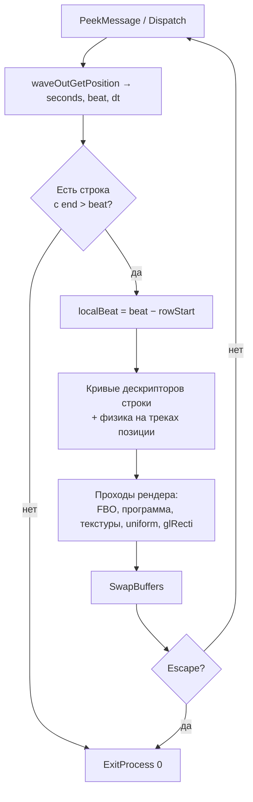

# 2. Главный цикл

Время задаёт только позиция воспроизведения звука. Каждый кадр переводит её в секунды и биты, выбирает строку таймлайна, считает анимацию и физику и рисует цепочку шейдеров. На бите 600 программа завершается.

## Инициализация

Синтез музыки идёт в отдельном потоке параллельно с подготовкой графики. Воспроизведение запускается последним.

| Адреса | Шаг |
|---|---|
| `0x406379` | Инициализация синтезатора `0x4010e3`: партитура, патч, граф, `gm.dls` |
| `0x40639f` | `CreateThread(0x401636, 0x00f02070)` — синтез всей музыки в буфер |
| `0x4063b9..0x40640d` | Окно, DC, pixel format, контекст WGL; размер окна → `0x0b17bf2c` / `0x0b17bfac` |
| `0x406430..0x40648d` | Экран загрузки: шейдер `0x426c58` рисуется, пока `GetTickCount` не отсчитает 1 с |
| `0x40648f..0x4064c0` | Копирование параметров физики 4 персонажей |
| `0x4064e7..0x406dac` | Сборка массивов указателей на исходники шейдеров (цепочка `MOV`) |
| `0x406dad..0x406ded` | 30 программ: `glCreateShaderProgramv(GL_FRAGMENT_SHADER, n, strings)` |
| `0x406e01..0x406f7a` | 13 FBO и 15 текстур RGBA32F |
| `0x406f9c..0x407987` | Треки строки 0 и проходы инициализации: генерация атласов |
| `0x4079d6` / `0x407a58` | Чтение атласа облаков на CPU → 3D-текстура 128³ |
| `0x407ae9..0x407b0c` | `waveOutOpen` → `waveOutPrepareHeader` → `waveOutWrite` всего буфера |

Буфер из 19 964 544 кадров уходит на воспроизведение целиком, пока поток ещё пишет в него. Это работает, потому что синтез идёт быстрее реального времени.

Формат звука (`0x43702c`): IEEE float, стерео, 44 100 Гц, блок 8 байт.

## Часы

Секунды и бит считаются из позиции воспроизведения в сэмплах, с округлением до float32 на каждом шаге:

```
waveOutGetPosition(&mmtime{wType = TIME_SAMPLES})   // cursor: u32 в 0x437024
seconds = f32( f32(f64(cursor)) / 44100 )
beat    = f32( seconds * f32(80/60) )               // 80 BPM
dt      = f32( seconds - prevSeconds )              // prevSeconds = 0 на старте
```

Точки округления (double → float → деление) определяют, в какую строку попадает кадр на границе. `GetTickCount` нужен только экрану загрузки.

## Кадр



| Шаг | Адрес |
|---|---|
| Сообщения окна | `0x407b6e` |
| Позиция воспроизведения | `0x407b91` |
| Выбор строки | `0x407bee` |
| Кривые | `0x407c64` |
| Физика | `0x408291` |
| Проходы рендера | `0x4082c4` |
| `SwapBuffers` | `0x4085fd` |
| Проверка Escape | `0x408603..0x408611` |

## Завершение

Программа выходит, когда для текущего бита нет строки: бит 600 = 450 с = cursor 19 845 000 → `0x407c20` → `ExitProcess(0)` в `0x408618`.

Звук длиннее картинки: 19 964 544 кадров = 452,71 с. Последнее событие партитуры — на сэмпле 19 897 792, так что хвост после 450 с реально сгенерирован.

## Детерминизм

Картинка — функция позиции воспроизведения и истории физики.

- При позиции `735·n` (44 100 / 60) получается ровно 27 000 кадров `0..26999`. Запрос `n = 27000` — это бит 600 и выход.
- Физика зависит от последовательности `dt`, поэтому кадр нельзя посчитать отдельно от предыдущих.
- Графика не вызывает ГСЧ: шум и зерно — хеши координат и времени в шейдерах.
- FP-режим главного потока: x87 CW `0x027f` (53 бита, к ближайшему), MXCSR `0x1f80`. У потока синтеза свой режим, см. [06-audio.md](06-audio.md).
