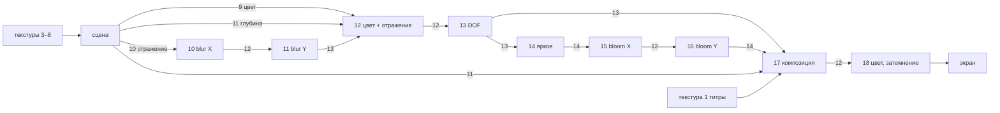

# 5. Рендеринг

Каждый кадр — 19 полноэкранных проходов fragment-шейдеров: 9 проходов инициализации, raymarching сцены по SDF и 9 проходов постобработки. Геометрии нет, каждый проход — `glRecti(-1, -1, 1, 1)` с фиксированным вершинным конвейером.

## Шейдеры

30 программ собраны из 93 фрагментов GLSL общим объёмом 117 040 байт.

- Рецепты `(count, offset)` в `0x4357e0` указывают, какие фрагменты склеить. Общая библиотека (математика SDF, шум, освещение, raymarcher) входит во все сцены.
- Программы создаются через `glCreateShaderProgramv`, отдельного vertex shader нет.
- Выходы `outColor0/1/2` объявлены без `layout(location)` и привязываются неявно при линковке.
- Программа 0 объявлена как `#version 450`, но использует возможности compatibility-профиля. На строгих драйверах ей нужен заголовок `#version 450 compatibility`.

## Ресурсы

**FBO** — 13 штук, записи в `0x4358d0` с шагом 20 байт: `(attachments, width, height, divisor, initOnly)`. При `width = 0` берётся размер окна, целочисленно делённый на `divisor`.

**Текстуры** — 15 штук RGBA32F, уровень 0, фильтр LINEAR:

| Индекс | Размер | Назначение |
|---|---|---|
| 0 | 16384 × 128 | атлас облаков → объём 128³ |
| 1 | 4096² | буквы для титров (SDF) |
| 2, 3 | 1024² | полосы шума, бесшовный шум |
| 4, 5, 6 | 2048² | Вороной, панели (высота и производные) |
| 7, 8 | 1024² | звёзды |
| 9, 10, 11 | размер окна | выходы прохода сцены |
| 12, 13, 14 | размер окна | буферы постобработки |

У текстур инициализации wrap REPEAT, у текстур таймлайна `GL_CLAMP` (`0x2900`), а не `CLAMP_TO_EDGE`.

## Генераторы текстур (программы 0–8)

Все текстуры процедурные: их рисуют 9 шейдеров при запуске.

| Прог. | Что генерирует |
|---|---|
| 0 | Атлас облаков. R — 5 октав value noise и инвертированный 3-октавный Worley; G/B — инвертированный 32-октавный шум на частотах 48 / 192 |
| 1 | Атлас букв для титров (SDF из макросов глифов) |
| 2 | 4 полосы simplex-шума |
| 3 | Бесшовная версия полос (сдвиг и смешивание) |
| 4 | Периодический Вороной: расстояние, граница, клетка |
| 5, 6 | Манхэттенский Вороной, высота и производные панелей |
| 7, 8 | 10 000 звёзд из хешей, яркость 0.0034 / 0.0025 |

**Объём облаков.** Атлас 0 читается на CPU (`glGetTexImage`, `0x4079d6`) и загружается как 3D-текстура 128³ (`0x407a58`) без перестановки: воксель `(x, y, z)` = пиксель атласа `(x + 128·y, z)`. Шейдер обращается к нему по координате `(x + 0.5, z + 0.5, y) / 128`. Текстура висит на юните 0 как `uClouds`, LINEAR, REPEAT.

## Проход сцены (программы 9, 19–29)

Сцена рисуется sphere tracing'ом по функции расстояния и выдаёт три буфера.

Состав: uniform `0x40ae60`, SDF-математика `0x40b1a8`, хеш и шум `0x40d358`, модели `0x40f488`, материалы `0x4117e8`, UI `0x4123a8`, освещение `0x415e80`, raymarcher `0x4184b8` и фрагмент конкретной сцены.

Шаги raymarcher:
1. Sphere tracing по SDF.
2. Нормаль — конечные разности плюс bump.
3. Ambient occlusion по 4 расстояниям.
4. Освещение и туман сцены.
5. Одно вторичное отражение.
6. Облака — только в программах 20 и 21: до 40 выборок плотности, по 3 теневых на каждую.

| Выход | RGB | Alpha |
|---|---|---|
| `out0` | основной цвет | вес отражения |
| `out1` | цвет отражения | радиус размытия (шероховатость) |
| `out2` | глубина | — |

## Граф проходов

| Проход | Вход | Выход | Что делает |
|---|---|---|---|
| сцена | 3, 4, 5, 6, 7, 8 | 9, 10, 11 | raymarching |
| 10 | 10 | 12 | размытие отражения по X: 15 пар отсчётов, треугольные веса, радиус из alpha |
| 11 | 12 | 13 | то же по Y |
| 12 | 9, 13, 11 | 12 | цвет плюс взвешенное отражение, глубина в alpha |
| 13 | 12 | 13 | DOF: 4 спирали × 15 отсчётов, 7-угольная диафрагма, CoC из `uSharpDistance` / `uBlurSize` |
| 14 | 13 | 14 | выделение ярких: `max(color - 1, 0)` |
| 15 | 14 | 12 | bloom по X: 19 пар, `uBloomKernelSize` |
| 16 | 12 | 14 | bloom по Y |
| 17 | 13, 14, 11, 1 | 12 | bloom, титры, виньетка, зерно (хеш от времени) |
| 18 | 12 | экран | цветокоррекция, clamp, затемнение |

Затемнение задаёт шейдер `0x41b0b0`: появление за первые 4 с, провал около бита 554 (415,5 с), уход в чёрное к биту 597 (447,75 с).

## Uniform и текстуры

Каждый проход получает `uTimeResolution = (globalSeconds, passWidth, passHeight)`. Бит шейдер считает сам: `uTimeResolution.x · 80/60`.

- Входные текстуры: базовая location массива `sTD2DInputs` плюс индекс, юнит `index + 1` (`0x40842b..0x40844a`). Юнит 0 занят `uClouds`.
- Загружаются только uniform из дескрипторов текущей строки (`0x4084b5..0x40850d`).

**Uniform хранятся в объекте программы.** Если строка не задаёт uniform, программа использует значение, загруженное в неё последним, возможно много сцен назад. Пример: строка 43 (программа 21) не задаёт `uMainCharacterPos`, и в шейдере остаётся значение из строки 11, хотя физика с тех пор ушла далеко.

**Проходы 0–8 выполняются в каждом кадре.** В цикле дескрипторы инициализации пропускают настройку FBO, программы и uniform, но `glRecti` всё равно вызывается (`0x4082df → 0x4085c9`): 9 рисований с состоянием, оставшимся от предыдущего прохода.
