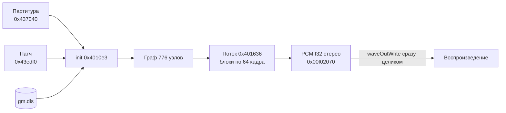

# 6. Звук: синтезатор 64klang2

Музыка не хранится как звук. В EXE лежат партитура, граф синтеза и код узлов; при запуске поток синтеза рассчитывает все 452,71 с в буфер PCM на 160 МБ.

Код соответствует публичному плееру 64klang (`gopher-atz/64klang`, коммит `23d7cfc`, 2018): совпадают все 79 констант и ГСЧ, весь расчёт музыки совпадает побитово. Отличия перечислены в конце.

## Поток данных



## Инициализация (`0x4010e3`)

1. **Дельта-декодирование.** Всё от `0x437050` до `0x43edcb` — один поток: каждый байт = предыдущий + текущий (mod 256), без сброса между частями.
2. Константы патча: 200 моно и 27 стерео float32 → float64.
3. Рекурсивное создание узлов графа (`0x405de9` / `0x405e78`).
4. Загрузка `gm.dls` (см. [01-packing-and-startup.md](01-packing-and-startup.md)): каждый чанк `data` — сэмпл PCM16, переводится в float64 делением на 32 768, дублируется по времени и в оба канала. Частоты дискретизации из банка не читаются.
5. Счётчик тиков `0x0b16bd20` = 1: нумерация с единицы.

## Партитура

Партитура — набор потоков событий, разложенных по байтовым плоскостям.

Заголовок `0x437040`: `f32 bpm, u32 frameLimit = 19964544, u32 quantum = 64, u32 deltaSize`.

Заголовок потока (u32):

| Биты | Поле |
|---|---|
| 0–15 | число событий |
| 16–23 | номер CC |
| 24–27 | тип: 0 — note off, 1 — note on, 3 — CC |
| 28–31 | канал |

Плоскости (сначала все байты одной, потом следующей):
- 3 плоскости — 24-битное время, умножается на 64, то есть время кратно блоку;
- 1 плоскость — нота или значение CC;
- 5-я плоскость, только у note on — velocity.

Значение CC: селектор 0 → `(v − 128) / 128`, остальные → `v / 128`. Используются CC 0, 1, 2, 3, 4, 6. Всего 5 718 событий нот (2 859 пар) и 1 557 CC.

## Поток синтеза (`0x401636`)

Поток считает музыку блоками по 64 кадра, события партитуры применяются в начале блока.

```
MXCSR = 0xffc0                   // к нулю, FTZ, DAZ — только в этом потоке
for block in 0 .. 311946:
    по каждому потоку событий по порядку: выдать события с time <= текущий сэмпл
    repeat 64:
        L, R = tick(корень графа)
        buf[i] = (f32 L, f32 R)
        tick += 1
        освободить отложенные блоки памяти
```

Итого 19 964 544 кадров. Параметры узлов пересчитываются раз в 16 сэмплов, когда `(tick & 15) == 1`.

## Граф (патч)

Патч — последовательность WORD с адреса `0x43edf0`; узлы ссылаются друг на друга смещениями.

- Заголовок узла: биты 0–6 — тип, 7–13 — число входов, бит 15 — глобальный узел.
- Далее WORD-ссылки на входы, затем слова режима.
- 776 узлов, 46 типов, 43 разные tick-функции. Таблицы: tick `0x4096c0`, init `0x4097e0`.
- Граф допускает общие узлы и циклы. Узел хранит номер тика последнего вычисления (`node + 0x14`) и в том же тике возвращает кешированное значение.

**Голоса.** Нота проходит через контроллеры нот канала к первому подходящему диапазону, и менеджер голосов создаёт копию подграфа голоса. Голос живёт, пока открыт гейт его ADSR. Ноты получают 35 из 37 менеджеров. Арпеджиатор один (канал 5): 32 шага velocity / gate / transpose, данные в `0x440bea`.

## Ядра узлов

| Узел (адрес) | Алгоритм |
|---|---|
| ADSR `0x40226d` | 5 входов; время `1 / (max(x, 0)³ · 418381.75 + 1)`; спад линейный или экспоненциальный; активен в атаке или пока уровень > 1/65536 |
| OSCILLATOR `0x402c12`, LFO `0x402aa8` | синус, пила, пульс, бандлимит-треугольник и пульс, шумовой тон; унисон — последовательная расстройка; случайная фаза — всегда 7 вызовов ГСЧ |
| NOISEGEN `0x402db1` | белый, розовый (3 полюса), коричневый шум |
| BQFILTER `0x403008` | биквад DF-II-T, `Q = exp2(in · 10)`, каскад |
| SVFILTER `0x405986` | state-variable, 2 прохода на сэмпл |
| ONEPOLE, ONEZERO, DCFILTER | фильтры первого порядка |
| FORMANT `0x405b62` | 5 резонаторов на гласную, таблица 375 коэффициентов |
| DISTORTION `0x403c97` | овердрайв, мягкое ограничение, лимитер |
| COMPEXP `0x40477a` | компрессор / экспандер, огибающая в лог-домене, `ratio = exp2(in · 6)` |
| DELAY, COMBDELAY, FBDELAY | стерео-буфер 4 с, задержка в `[4, 176399]`, линейная или allpass-интерполяция, синхронизация с BPM |
| REVERB `0x4044f1` | 8 параллельных comb и 4 последовательных allpass, стерео-сдвиг 23 сэмпла |
| TRIGGER, TRIGGERSEQ | порог 0.5; пошаговый секвенсор из 2 банков паттернов |
| SAMPLER `0x404dd0`, GMDLS `0x405b12` | сэмпл из банка, линейная интерполяция, питч, луп |
| GLITCH `0x40514d` | tape stop, ретриггер, перемешивание, реверс по записанному буферу |
| MUL, ADD, MIX, CLIP, PAN и др. | арифметика и маршрутизация |

## Математика

Синтезатор использует свою математику, а не libm; от неё результат зависит побитово.

- `s_rand` (`0x401038`): знаковое умножение 32×32→64 (`PMULDQ`), перестановка, конвертация младшего слова.
- `s_exp2` (`0x401066`): целая и дробная части, 6 шагов полинома, сборка экспоненты.
- `sin`: приведение диапазона и полином. `log2`: экспонента и мантисса плюс нечётный полином от `(m − 1) / (m + 1)`.
- Всё в float64 SSE2, умножение и сложение — отдельными операциями.

ГСЧ два: глобальный (`0x0b16b810`) и локальный у каждого GLITCH (`node + 0x190`). При перемешивании GLITCH временно подменяет глобальное состояние своим.

## Сэмплы

Звучат 15 сэмплов банка, 85 548 байт PCM16. В графе 23 сэмплера и 17 узлов GMDLS со ссылками на 16 сэмплов, но сэмпл 266 висит на голосе, которому не приходят ноты. Если обнулить в банке всё, кроме этих 15, результат побитово не меняется.

## Отличия от публичного 64klang

| Что | В бинарнике | В исходниках |
|---|---|---|
| Освобождение памяти | после каждого сэмпла | после блока из 64 |
| Флаг `renderDone` | не пишется, конец — выход потока | пишется |
| Входов у ADSR | 5 (`ADSR_SKIP_TRIGGER_GATE`) | 7 |

Звук влияет на графику только через позицию воспроизведения. Амплитуды и события из PCM главный цикл не читает.
