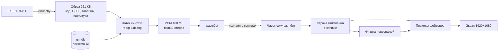

# Eidolon «Poo-Brain»: как устроен оригинальный бинарник

Интро длиной 450 секунд целиком считается при запуске из 60 928 байт: музыку синтезирует граф 64klang, картинку рисуют полноэкранные fragment-шейдеры по таймлайну, синхронизированному с позицией воспроизведения звука.

English version: [../en/README.md](../en/README.md)

**Объект:** `Eidolon - Poo-Brain (native).exe`, 60 928 байт, SHA-256 `376b476c358a969da7d5d45c091355520453086ee8cd22625fdbb4fa3a9fd6be`; Revision 2017, категория 64k. Музыка — 64klang2 (Gopher). Версии 720p и 1080p отличаются от него 24 байтами констант разрешения.

## Общая схема

## Файлы

| Файл | Содержание |
|---|---|
| [01-packing-and-startup.md](01-packing-and-startup.md) | Структура EXE, распаковщик kkrunchy, импорт, путь передачи управления, `gm.dls` |
| [02-main-loop.md](02-main-loop.md) | Инициализация, часы, шаги кадра, выход |
| [03-timeline-and-curves.md](03-timeline-and-curves.md) | Таймлайн, сцены, дескрипторы uniform, кривые, камера |
| [04-physics.md](04-physics.md) | Пружинная физика персонажей |
| [05-rendering.md](05-rendering.md) | Ресурсы GL, генераторы текстур, raymarcher, постобработка |
| [06-audio.md](06-audio.md) | Синтезатор: партитура, граф, ядра узлов, сэмплы |
| [07-size.md](07-size.md) | Из чего состоят 60 928 байт и почему 32 КиБ недостижимы |

## Обозначения

- Адреса — виртуальные адреса распакованного образа, база `0x400000`.
- `f32(x)` — округление до float32. Порядок операций в формулах соответствует машинному коду; от него зависит побитовое совпадение.
- Интервалы полуоткрытые: `[a, b)`.

## Ключевые адреса

| Адрес | Что |
|---|---|
| `0x401000..0x408647` | Код приложения, 30 279 байт |
| `0x4010e3` | Инициализация синтезатора |
| `0x401636` | Поток синтеза |
| `0x406019` | Физика персонажа |
| `0x406379` | Точка входа приложения |
| `0x407b84..0x408603` | Тело главного цикла |
| `0x409000..0x40909c` | Таблица импорта (IAT) |
| `0x4090b8` | 79 констант синтезатора, float64 |
| `0x4096c0` / `0x4097e0` | Таблицы tick / init узлов синтеза |
| `0x409918…` | Исходники GLSL, 93 фрагмента |
| `0x426de0` | Пул ключей кривых |
| `0x42fc50` | Таймлайн: 50 интервалов в битах |
| `0x42fde0` | Токены сцен, 50 × u32 |
| `0x42fea8` | Диапазоны треков строк, 50 × `(offset, count)` |
| `0x430038` | Дескрипторы uniform, шаг 40 байт |
| `0x4357e0` | Рецепты программ `(count, offset)` |
| `0x4358d0` | Описания FBO, шаг 20 байт |
| `0x4359d0` | Маршруты проходов `(program, fbo)` |
| `0x435e2c` | Списки проходов по токенам |
| `0x4361f0` | Указатели на имена uniform |
| `0x437020` | `MMTIME`, позиция воспроизведения |
| `0x43702c` | `WAVEFORMATEX` |
| `0x437040` | Заголовок партитуры |
| `0x43edd0` | `WAVEHDR` |
| `0x43edf0` | Патч, граф синтеза |
| `0x4c0c70` | Буфер файла `gm.dls` |
| `0x00f02070` | Буфер PCM, 159 716 352 байт |
| `0x0b17bdf0` | 4 записи физики по 64 байта |
