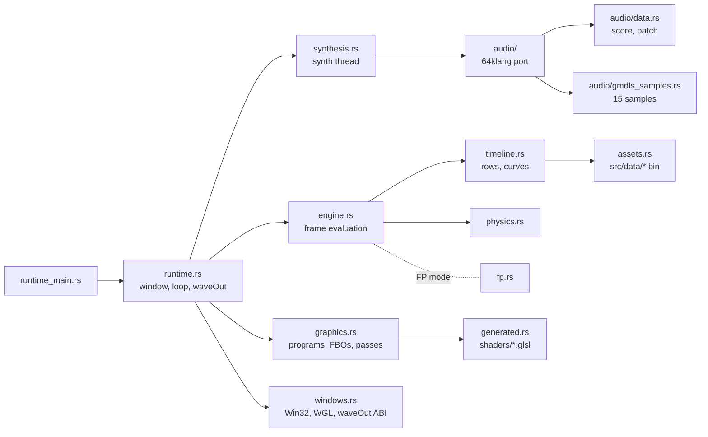

# Eidolon in Rust: how the port works

The port reproduces the original intro byte for byte: same 27 000 frames, same 19 964 544 PCM frames. It keeps the original's algorithms, data, operation order and OpenGL calls. Only the container changes: Rust instead of packed x86 code.

How the original works is described in [docs/en](../en/README.md); this section covers the Rust side.

The module paths and architecture below describe the regular `src/` build.
The compact `size/crate/` variant and its modified assembly packer are covered
in [Size-optimized variant](#size-optimized-variant).

| File | Contents |
|---|---|
| [README.md](README.md) | Architecture, executables, differences from the original |
| [asm-map.md](asm-map.md) | Which Rust module implements which part of the original binary |
| [verification.md](verification.md) | How equality with the original is checked |

## Executables

Both are built for `i686-pc-windows-gnu`, a 32-bit Windows target like the original.

| Binary | Mode | What it does |
|---|---|---|
| `eidolon-runtime.exe` | `--play` | Normal playback: window, OpenGL, waveOut |
| | `--capture FILE` | Controlled clock (frame `n` at sample `735·n`), no audio; writes the SHA-256 of every frame |
| | `--graphics-diagnostic` | Controlled clock without audio or hashing |
| `eidolon-engine` | `--pcm-sha256` | Synthesizes the whole soundtrack on the CPU and prints its SHA-256 |
| | `--render-pcm FILE` | Writes the soundtrack as raw stereo float32 |
| | `--raw-stream`, `--state-stream`, `--shader-stream` | Binary dumps of uniforms, physics state and shader sources for the research verifiers |

`eidolon-engine` has no window or GPU code, so it also builds for the host (Linux, Windows; x86 or x86_64 only).

## Architecture

| Module | Role |
|---|---|
| `runtime.rs` | Startup order, loading screen, frame loop, waveOut playback, `--capture` |
| `engine.rs` | Per frame: clock → row → curves → physics → uniforms; tracks which uniforms each program object holds |
| `timeline.rs` | Row selection and Hermite curve evaluation in native float32 order |
| `physics.rs` | Spring physics of the characters, instruction by instruction |
| `graphics.rs` | Shader programs, 13 FBOs, 15 textures, 128³ cloud volume, the pass loop |
| `assets.rs`, `generated.rs`, `src/data/` | The original's tables and shader recipes, read from the binary unchanged |
| `fp.rs` | x87 control word / MXCSR of the graphics thread and x87 `sqrt`/`atan2`/`acos` helpers |
| `contract.rs`, `synthesis.rs` | Clock constants, PCM size and the synth thread interface |
| `windows.rs` | Hand-written Win32, WGL, OpenGL 1.1 and WinMM declarations with ABI size checks |
| `observe.rs` | Exported marker the research capture hooks into; a no-op for normal runs |
| `sha256.rs` | Dependency-free SHA-256 for `--capture` and `--pcm-sha256` |
| `audio/` | 64klang2 player: score decoder, graph, voices, node kernels, math helpers |

## Exactness rules

The port is exact because it copies the original's arithmetic, not just its formulas.

- **Float operation order.** Every `f32`/`f64` expression keeps the native order and rounding points; no fused multiply-add, no algebraic simplification.
- **FP modes.** The graphics thread runs with x87 CW `0x027f` and MXCSR `0x1f80`; the synth thread with MXCSR `0xffc0` (round toward zero, FTZ, DAZ), as in the original.
- **Own math.** `sqrt`, `atan2`, `acos` use x87 instructions (`fp.rs`); the synthesizer uses 64klang's own `exp2`, `log2`, `sin` and RNG (`audio/math.rs`), never `libm`.
- **Data unchanged.** Curves, timeline, pass routes and GLSL come byte for byte from the unpacked original; duplicate curve keys and overlapping table views are kept.
- **Stateful quirks kept.** Uniforms persist per program object; the nine initialization passes still draw every frame; physics records survive scene changes.

## Differences from the original

| | Original | Rust |
|---|---|---|
| Start of playback | Plays while the synth thread is still writing the buffer | Waits until the whole soundtrack is synthesized (a few minutes) |
| Instrument samples | Reads the system `gm.dls` | Embeds the 15 samples it uses |
| Shader program 0 | `#version 450` | `#version 450 compatibility`, needed by strict drivers; the reference was captured with the same header |
| Size | 60 928 bytes, packed | about 730 KB unpacked; compact variant below |
| Extra modes | — | `--capture`, `--pcm-sha256`, diagnostic streams |

## Size-optimized variant

The integrated compact build is **44 139 bytes**, down from the previous
47 561-byte build. A clean checkout reproduces its exact SHA-256, and the
delivered EXE passed the full frame and audio comparison. The evidence is
recorded in [size/README.md](../../size/README.md#verification).

| Area | Compact implementation |
|---|---|
| Runtime | `size/crate/`: `no_std`, custom entry/allocator/imports and a fixed playback path; natural completion calls `ExitProcess` |
| Samples | Reads and checks the standard 3 440 660-byte system `gm.dls` bank |
| Audio data | Generated compact patch/score streams, controller deltas, unused graph inputs removed and unused formant rows zeroed |
| Graphics data | `graphics.cg29`: compact tables and the reconstructed fo2 shader pool; source bytes and fragment order differ from the regular build |
| DSP code | Selected routines kept out of line; backend flags chosen using complete packed-file size |
| Linker | Validated content-derived constant sections and a frozen function/data order, followed by conservative FP-load redirection |
| Packer | Modified kkrunchy: 14 contexts, 8 mixers, compact assembly decoder and import table |

The size build's data reductions and shader transformations have their own
checks. Exact representable constant-only products are folded, while runtime
floating-point evaluation order and FP modes remain part of the media contract.
The regular runtime's `--capture` mode does not exercise this packed executable;
use the [packed-image verification workflow](verification.md#size-build-verification).

Build commands and the current expected-hash policy are in
[size/README.md](../../size/README.md); the low-level source map is in
[asm-map.md](asm-map.md#compact-build-and-modified-assembly).
